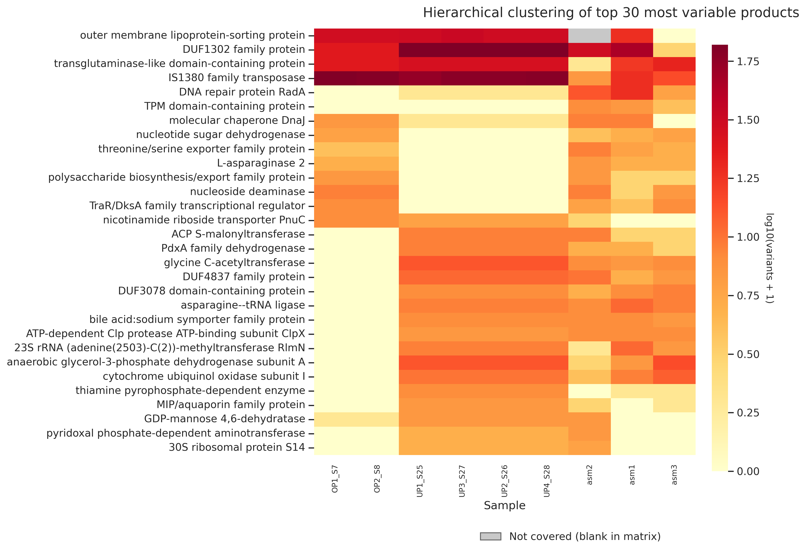
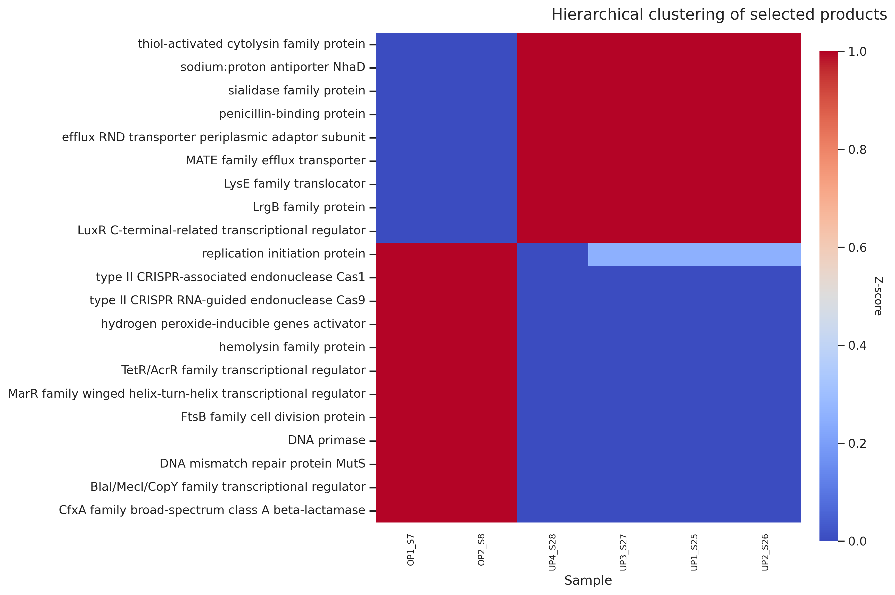

# bacterial-variant-matrix-pipeline

Reference-guided comparative genomics workflow for bacterial isolates using paired-end sequencing reads, joint variant calling, gene-product matrix generation, and heatmap visualization.


## Overview

This repository provides an end-to-end workflow for comparative genomic analysis of bacterial isolates using a reference genome assembly and paired-end sequencing reads.

The pipeline performs:

1. Read alignment against a reference genome
2. Joint variant calling across isolates
3. Aggregation of variants by annotated gene product
4. Generation of sample-by-product variant matrices
5. Identification of highly variable gene products
6. Visualization of variant patterns through clustered heatmaps

The workflow is designed for any bacterial species provided that:

- A reference FASTA file is available
- A corresponding GFF annotation file is available
- Paired-end FASTQ files are available for each isolate

## Repository Structure

bacterial-variant-matrix-pipeline/
│
├── scripts/
│   ├── call_variants.sh
│   ├── build_product_variant_matrix.py
│   ├── select_products.sh
│   └── plot_selected_products_heatmap.py
│
├── reference/
│   ├── genome.fna
│   └── genome.gff
│
├── fastq/
│
├── results/
│
├── example_output/
│
└── README.md

The FASTA and GFF files should correspond to the same reference assembly.

## Software Requirements

### Variant Calling

BWA >= 0.7.17
SAMtools >= 1.21
BCFtools


### Python
Python >= 3.10
pandas
numpy
scipy
matplotlib
seaborn

Install Python dependencies:

pip install pandas numpy scipy matplotlib seaborn

## Pipeline Workflow

Paired-End FASTQ Files
            │
            ▼
call_variants.sh
            │
            ▼
variants.vcf
variant_summary.txt
            │
            ▼
build_product_variant_matrix.py
            │
            ▼
variants_per_product_matrix.csv
variants_table.tsv
            │
            ├──────────────► plot_selected_products_heatmap.py
            │                            │
            │                            ▼
            │              Top-N Variable Products
            │
            ▼
select_products.sh
            │
            ▼
selected_genes.tsv
            │
            ▼
plot_selected_products_heatmap.py
            │
            ▼
Selected Product Heatmap

## Methods

Reads are aligned against a reference genome using BWA-MEM. Variants are jointly called using BCFtools and aggregated by annotated gene product using the supplied GFF annotation. Product-level variant counts are transformed into a sample-by-product matrix and optionally standardized using Z-score normalization prior to heatmap generation.

---

# Step 1: Variant Calling

Align reads to a reference genome and perform joint variant calling.

## Usage

```bash
bash call_variants.sh \
    path/to/reference/genome.fna \
    path/to/trimmed_fastq \
    results
```

## Inputs

Reference FASTA
Paired-end FASTQ files


## Outputs
results/
├── variants.vcf
└── variant_summary.txt
```

### Example Variant Summary

Sample     Total_variants    SNPs    Indels
Isolate1   58364             56663   1701
Isolate2   57902             56200   1702
Isolate3   57486             55792   1694


# Step 2: Build Product-Level Variant Matrix

Convert variant calls into a sample-by-product matrix using the reference annotation.

## Usage

python3 build_product_variant_matrix.py \
    results/variants.vcf \
    reference/genome.gff \
    results

## Inputs

variants.vcf
genome.gff


## Outputs

results/
├── variants_table.tsv
└── variants_per_product_matrix.csv


The matrix structure is:

Sample      Cas1   Tet(Q)   CfxA
Isolate1      2       5       0
Isolate2      1       8       3


# Step 3: Generate Curated Product List

Create a biologically curated list of products of interest.

Current targets include:

- CRISPR-associated proteins
- Antimicrobial resistance proteins
- Efflux transporters
- Virulence-associated proteins
- DNA repair proteins
- Replication proteins
- Transcriptional regulators

## Usage

bash select_products.sh results


## Output

results/
└── selected_genes.tsv


# Step 4: Generate Heatmaps

The heatmap script supports two modes:

## A. Most Variable Products

Plot the most variable products across all isolates.

### Default (Top 20 Products)

python3 plot_selected_products_heatmap.py \
    results/variants_per_product_matrix.csv

### Custom Number of Products

python3 plot_selected_products_heatmap.py \
    results/variants_per_product_matrix.csv \
    20

Outputs:

results/
├── variants_per_product_heatmap_top20.png
└── products_plotted_top20.tsv


### Example Output



The heatmap displays products ranked by variability across isolates.


## B. Curated Product Panel

Plot products listed in:

selected_genes.tsv


Invariant products are automatically removed before plotting.

### Usage

python3 plot_selected_products_heatmap.py \
    results/variants_per_product_matrix.csv \
    results/selected_genes.tsv


Outputs:

results/
├── variants_per_product_heatmap_selected.png
└── products_plotted_selected.tsv


### Example Output



The heatmap displays a curated panel of biologically relevant gene products selected by the user.


## Pipeline Outputs

variants.vcf
variant_summary.txt
variants_table.tsv
variants_per_product_matrix.csv
selected_genes.tsv

products_plotted_selected.tsv
products_plotted_topN.tsv

variants_per_product_heatmap_selected.png
variants_per_product_heatmap_topN.png


